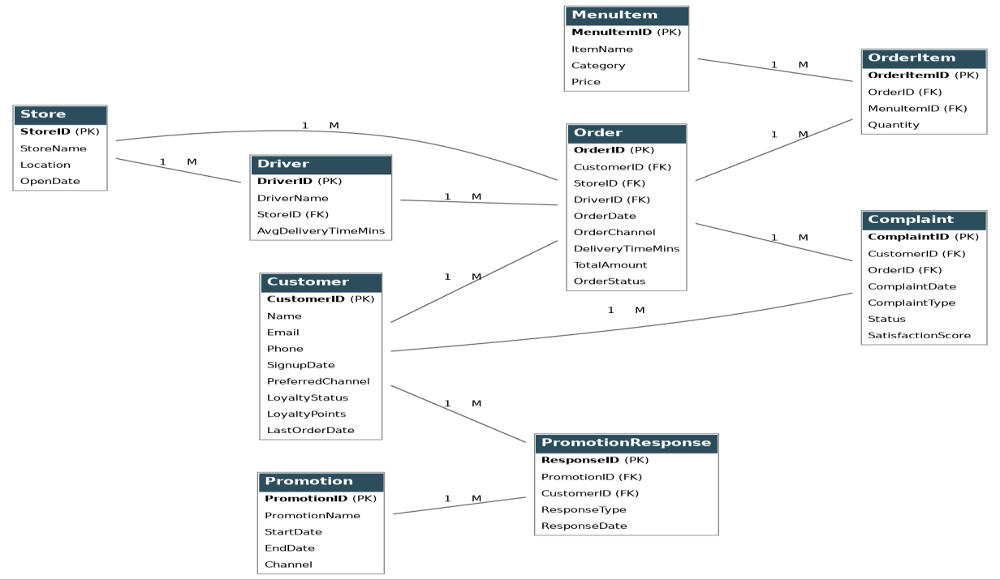
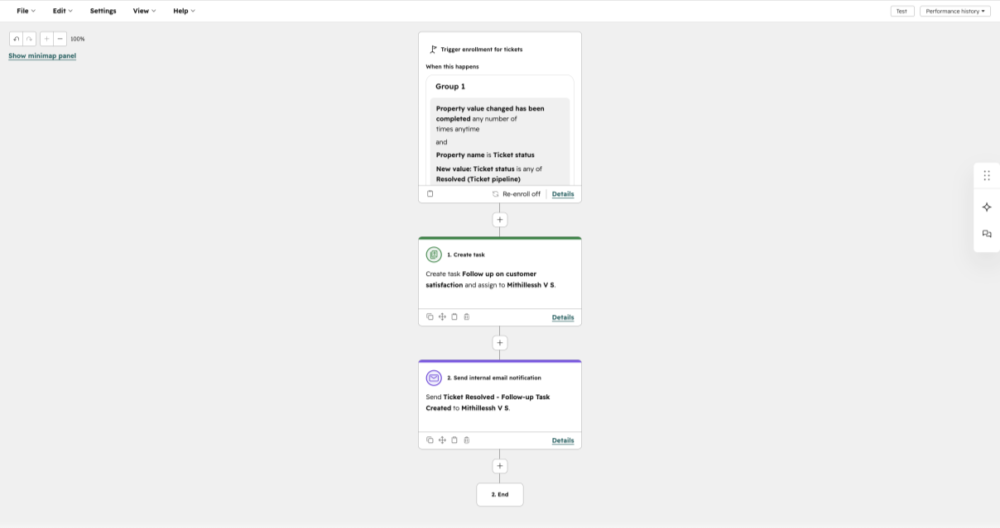
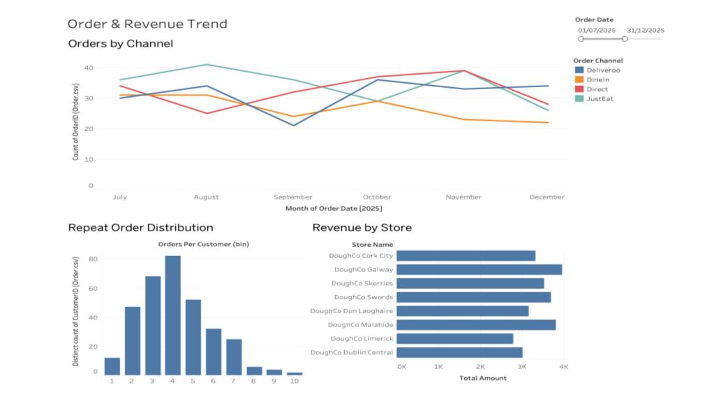
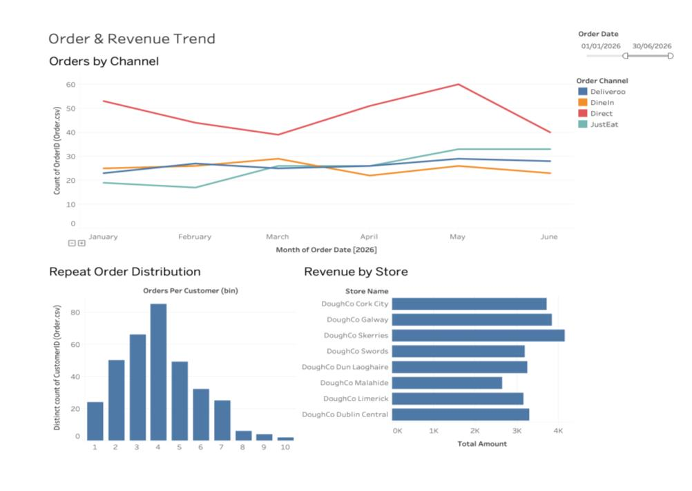
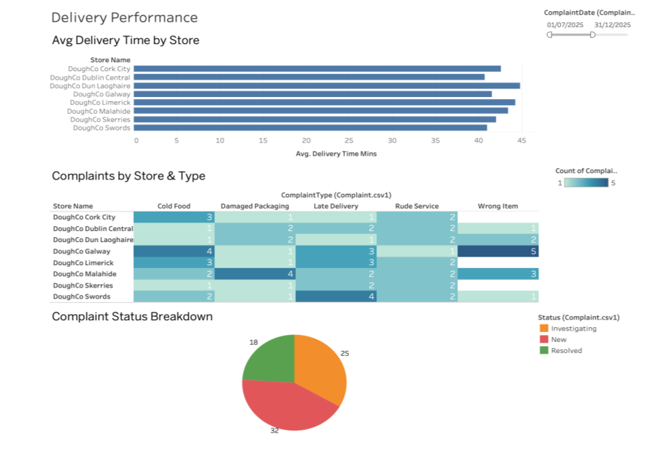
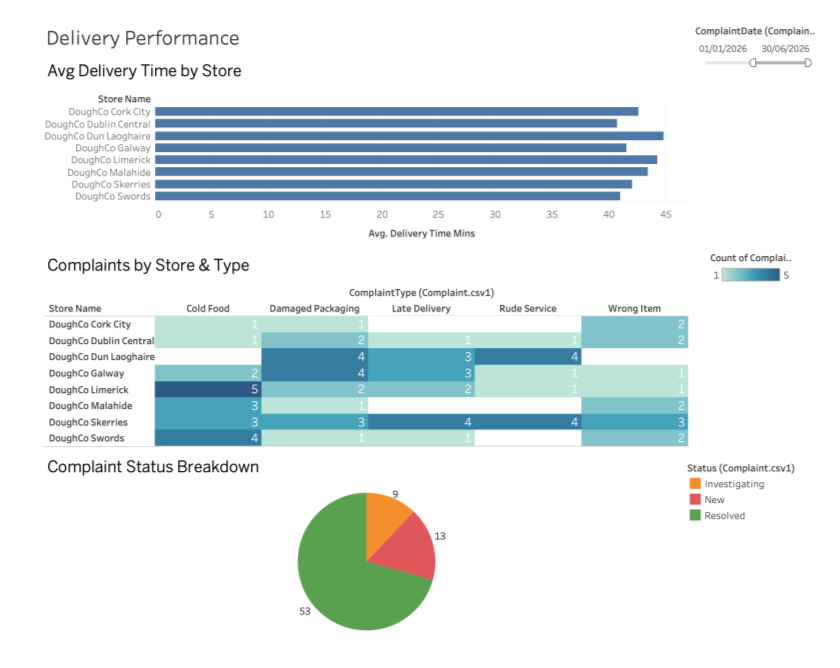
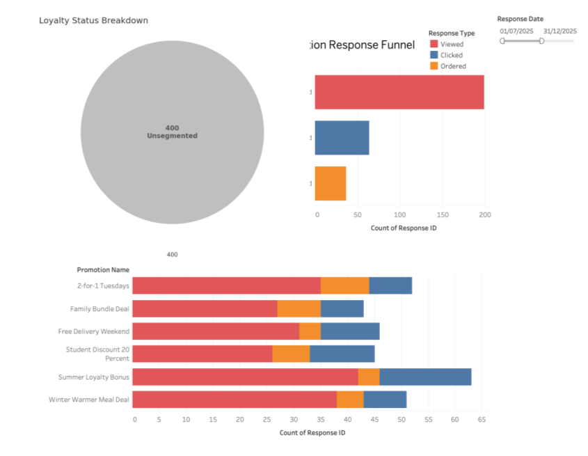
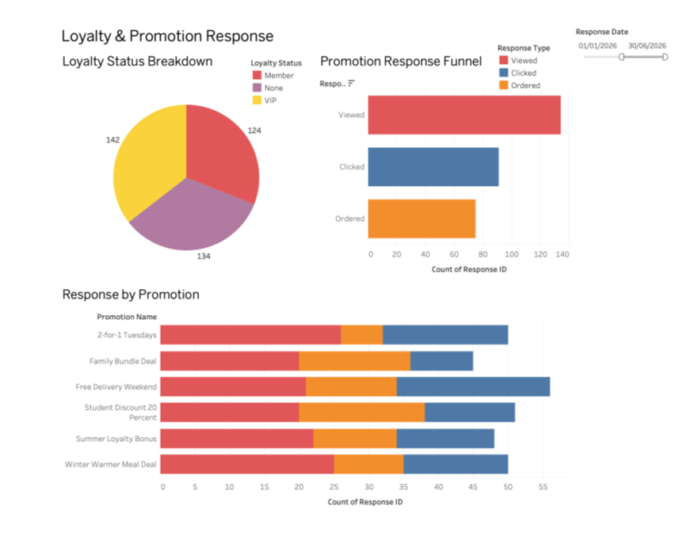

# DoughCo Pizza: CRM and BI Dashboards (HubSpot + Tableau)

A CRM and business-intelligence solution for a fictional 8-store Irish pizza chain that has lost direct customer relationships to third-party delivery apps. The project covers requirements analysis, a nine-entity relational data model, a **HubSpot CRM** with an automated complaint-ticket workflow, and **three Tableau dashboards**.

Built as an individual project for *Business Intelligence & Business Analytics* (MSc Data Analytics, National College of Ireland). I acted as the BI/BA consultant.

> **Important:** all data is **synthetic** (generated with Mockaroo), and the before/after results are a **deliberate mock-up** of the improvement a live system would aim to deliver, not measured outcomes. See [Results and limitations](#results-and-limitations).

## The business problem

DoughCo's orders increasingly flow through Just Eat and Deliveroo, which charge 20-30% commission and keep the customer data. DoughCo had:

- no CRM or single customer profile,
- no loyalty programme,
- ad hoc complaint handling (phone, in person, social media) with no tracking,
- no management reporting.

**Goals:** grow direct orders, build a CRM with loyalty tiers, introduce a structured complaint pipeline, and give management dashboards.

## Solution

| Layer | What I built |
|---|---|
| Analysis | EDA on orders, order items, complaints and promotion responses; SWOT and gap analysis |
| Data model | Nine entities (Customer, Order, OrderItem, MenuItem, Store, Driver, Complaint, Promotion, PromotionResponse) with primary and foreign keys |
| CRM (HubSpot) | 402 contacts with six custom properties (loyalty status, points, preferred channel, etc.); 150 complaint tickets in a New / Investigating / Resolved pipeline with dropdown-controlled fields |
| Automation | HubSpot workflow: when a ticket moves to *Resolved*, create a satisfaction follow-up task for the ticket owner (due in two business days) and send an internal notification email |
| Dashboards (Tableau) | 1) Order and revenue trend, 2) Delivery performance, 3) Loyalty and promotion response |

### Data model



| Table | Rows |
|---|---|
| Customer | 400 |
| Order | 1,500 |
| OrderItem | 3,500 |
| MenuItem | 40 |
| Store | 8 |
| Driver | 20 |
| Complaint | 150 |
| Promotion | 6 |
| PromotionResponse | 600 |

### CRM workflow



### Dashboards

**Dashboard 1: Order and revenue trend** (orders by channel, revenue by store, repeat-order distribution)




**Dashboard 2: Delivery performance** (delivery time by store, complaints by store and type, complaint status)




**Dashboard 3: Loyalty and promotion response** (loyalty tiers, promotion funnel, response by promotion)




## A technical challenge worth mentioning

Bulk-importing the 150 complaints as HubSpot tickets failed at the column-mapping step: *Pipeline* appeared as a required property that could not be mapped, even though the file had zero data errors. I:

1. used Chrome DevTools to find two failing backend requests, showing the fault was server-side rather than in my file;
2. reproduced it across different days, import modes and an upgraded trial plan to rule out plan limits;
3. escalated to HubSpot support with that evidence.

The cause: HubSpot's **CSV ticket import (unlike its API) requires an explicit Pipeline column in the file**, and the tool never says so. Adding that column fixed the import (150 rows, 0 errors). To keep the demo moving meanwhile, I created 20 sample tickets by hand.

Other practical lessons: HubSpot's free tier allows only 10 custom properties (so I combined customer and order IDs into one *Reference IDs* field), and date formats (DD/MM/YYYY vs MM/DD/YYYY) had to be checked at every stage.

## Results and limitations

The before/after figures below were **deliberately shaped in the synthetic data** to demonstrate how the dashboards would be used to judge business impact. They are **not** results from a real deployment.

| Metric | Before (Jul-Dec 2025) | After (Jan-Jun 2026) |
|---|---|---|
| Direct order share | 26.0% | 38.3% |
| Complaint resolution rate | 24.0% | 70.7% |
| Promotion-to-order conversion | 12.3% | 25.0% |

Delivery time was intentionally left unchanged (roughly 35-47 minutes per store), because a CRM cannot by itself make drivers faster.

Other known limitations:

- 108 of 1,500 orders have no matching OrderItem record (the tables were generated separately).
- Promotion responses were generated across one combined date range, so a few fall outside their campaign's own dates.
- The outbound marketing step (for example automated win-back emails) is out of scope.

## Repository structure

```
data/      Nine synthetic CSV tables used by Tableau and the CRM import
tableau/   Tableau workbook with the three dashboards
docs/      ER diagram, workflow and dashboard screenshots
```

## Opening the Tableau workbook

Open `tableau/doughco_dashboards.twb` in Tableau Desktop. If it asks for the data source location, point it to the `data/` folder. The workbook relates the nine CSV files and includes a second copy of the Complaint table so it can relate to both Customer and Order.

## Tech stack

HubSpot CRM (custom properties, ticket pipeline, workflows), Tableau, Mockaroo (synthetic data), CSV, relational data modelling.

## Data note

All records, including names, emails and phone numbers, are synthetic and generated for this exercise. Any resemblance to real people is coincidental.

## AI assistance

As acknowledged in my course submission, an AI assistant was used to help interpret the HubSpot import error and to render the entity-relationship diagram from a design I had already made. All design, data generation, CRM build and dashboards were my own work.

## Author

Mithillessh Vennila Sigamani: MSc Data Analytics, National College of Ireland.
